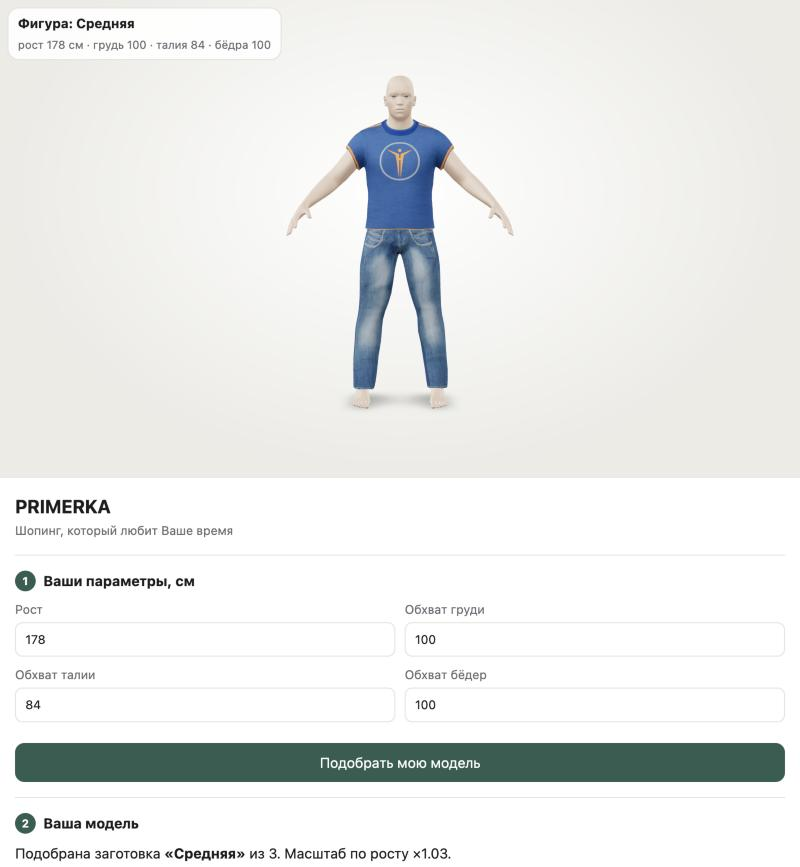

# PRIMERKA — примерка на заготовках (model-viewer)



Покупатель вводит замеры → программа выбирает ближайшую из 3 готовых фигур → покупатель выбирает вещь из каталога → видит, как она сидит, и получает рекомендацию размера.

## Запуск

1. Скачать проект: `git clone <адрес репозитория>` или **Code → Download ZIP** на GitHub (архив распаковать).
2. Открыть `index.html` двойным кликом (Chrome, Edge, Firefox, Safari).

Сервер, интернет и установка чего-либо не нужны. Модели встроены в `models/bundle.js`, а просмотрщик `<model-viewer>` лежит в `vendor/` как обычный скрипт: браузеры не загружают ES-модули со страниц, открытых из файла.

Можно открыть и через локальный сервер: `python3 -m http.server 8765` → http://localhost:8765

## Как работает

1. **Параметры:** рост, обхват груди, талии и бёдер.
2. **Модель:** из 3 заготовок (худощавая / средняя / плотная) выбирается ближайшая по груди, талии и бёдрам. Рост задаёт масштаб модели (`scale` в model-viewer), а обхваты сравниваются с поправкой на этот масштаб.
3. **Каталог:** 9 артикулов — 5 футболок и 4 джинсов. Артикул = вещь + цвет или принт. Геометрия одна на все артикулы, меняется только материал.
4. **Посадка:** размеры S–XL заранее подогнаны под каждую фигуру. Рекомендация размера строится по замерам покупателя и таблице размеров. Каждая зона получает оценку «тесно / в самый раз / свободно».

### Заготовки

| | Худощавая | Средняя | Плотная |
|---|---|---|---|
| Рост, см | 173 | 173 | 173 |
| Грудь, см | 91,6 | 99,3 | 106,2 |
| Талия, см | 68,1 | 80,6 | 94,3 |
| Бёдра, см | 88,8 | 99,3 | 105,5 |

Одна GLB на фигуру (`models/body_*.glb`, около 0,8 МБ). Внутри тело, глаза и 8 вариантов вещей: футболка и джинсы в размерах S, M, L, XL. У каждой пары «вещь + размер» свой материал с `alphaMode: MASK`. Страница показывает нужный вариант, выставляя прозрачность 1 или 0, и перекрашивает его через Materials API model-viewer (`setBaseColorFactor`, `setTexture`). Всего 3 фигуры × 2 вещи × 4 размера = **24 заготовки**.

### Почему так
- **model-viewer не умеет создавать модели**, он только показывает GLB. Поэтому модели собираются скриптом из готовых CC0-ассетов MakeHuman.
- **Все размеры в одной GLB:** model-viewer показывает одну модель за раз. Если грузить тело и вещи отдельными файлами, их нельзя совместить в одной сцене.
- **Цвет через материал:** один меш используется для многих артикулов, магазину достаточно задать цвет или текстуру.
- **Размер = сдвиг ткани по нормали** на `(обхват размера − обхват посадки) / 2π`. Тесный размер облегает тело, свободный висит. Футболка в зоне нахлёста всегда лежит поверх джинсов.

## Пересборка

```bash
python3 tools/build_presets.py
```

Нужна только стандартная библиотека Python. Настройки находятся в начале файла: `BODIES` — веса морфов MakeHuman для каждой фигуры, `GARMENTS` — таблица размеров.

## Структура

```
index.html                   приложение (4 шага, каталог, подбор размера)
models/body_{slim,avg,heavy}.glb   заготовки: фигура + вещи S–XL
models/textures/             print.png (оригинальная ткань), fabric.png (серый деним для перекраски)
models/presets.json          замеры фигур, таблица размеров, запас по зонам
models/bundle.js             всё одним файлом для запуска двойным кликом
tools/build_presets.py       сборка заготовок
tools/mhlib.py, pngio.py     чтение MakeHuman (obj/target/mhclo) и PNG
vendor/model-viewer.js       @google/model-viewer 3.5.0 (классический скрипт, без export)
source/makehuman/            исходные ассеты MakeHuman (CC0)
docs/                        PRIMERKA_description.docx — полное техническое описание, скриншоты
tools/make_doc.py            генерация описания: python3 tools/make_doc.py
```

## Лицензии

`vendor/model-viewer.js` — Google, Apache-2.0, см. `vendor/LICENSE-model-viewer.txt`.


Тело (`base.obj` hm08), морфы `macrodetails`, комплект `male_casualsuit04` и глаза `low-poly` взяты из MakeHuman system assets и выпущены под **CC0** (Data Collection AB, Joel Palmius, Jonas Hauquier). Указывать авторов не обязательно. Источник: https://github.com/makehumancommunity/makehuman и files.makehumancommunity.org.
